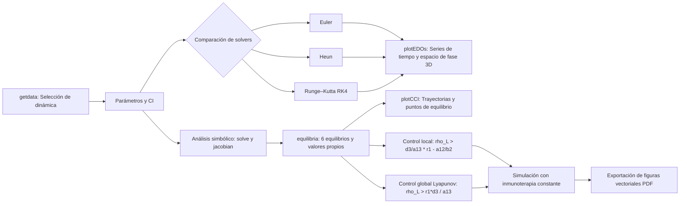

[](https://matlab.mathworks.com/open/github/v1?repo=emanuelalejandro9-web/MMP3)

# Práctica 2 — Caos en sistemas biológicos y control de células patológicas

Repositorio académico de la asignatura **Modelado Matemático**, correspondiente a la **Maestría en Ciencias de la Ingeniería** del Tecnológico Nacional de México / Instituto Tecnológico de Tijuana. La práctica integra modelado mecanicista de sistemas dinámicos no lineales en tres dimensiones, comparación de métodos numéricos de diferencias finitas, cálculo simbólico y numérico de puntos de equilibrio, análisis de estabilidad asintótica local mediante la matriz Jacobiana, localización de conjuntos compactos invariantes y análisis de estabilidad asintótica global mediante el método directo de Lyapunov.

El caso de estudio utiliza el modelo tridimensional de cáncer propuesto por **Itik y Banks (2010)** para representar la dinámica no lineal entre tres poblaciones celulares: células patológicas o tumorales, células normales o sanas y células efectoras del sistema inmune (citotóxicas o *Natural Killer*), evaluando tanto su comportamiento caótico natural como la dosis crítica de inmunoterapia $\rho_i$ necesaria para erradicar la población patológica.

**Docente:** Dr. Paul Antonio Valle Trujillo  
**Departamento:** Ingeniería Eléctrica y Electrónica  
**Institución:** Tecnológico Nacional de México / Instituto Tecnológico de Tijuana  
**Asignatura:** Modelado Matemático  
**Programa:** Maestría en Ciencias de la Ingeniería  

**Alumno:** Flores Gonzalez Emmanuel Alejandro. M26210085. m26210085@tectijuana.edu.mx

---

<a id="contenido"></a>
## Contenido

1. [Resumen](#resumen)
2. [Objetivos](#objetivos)
3. [Fuente y preparación de los datos](#datos)
4. [Modelo matemático](#modelo)
5. [Regímenes dinámicos y parámetros](#regimenes)
6. [Análisis matemático: Positividad y equilibrios](#analisis-equilibrios)
7. [Estabilidad asintótica local](#estabilidad-local)
8. [Conjuntos compactos invariantes y estabilidad global](#estabilidad-global)
9. [Métodos numéricos](#metodos)
10. [Flujo de trabajo computacional](#flujo)
11. [Actividades y secciones del cuaderno MATLAB](#actividades)
12. [Funciones auxiliares](#funciones)
13. [Estructura del repositorio](#estructura)
14. [Requisitos](#requisitos)
15. [Reproducibilidad](#reproducibilidad)
16. [Referencias](#referencias)

---

<a id="resumen"></a>
## Resumen

Esta práctica estudia la dinámica no lineal y el control de un sistema biológico tridimensional descrito por ecuaciones diferenciales ordinarias de primer orden que exhibe bifurcaciones, órbitas periódicas, ciclos límite y comportamiento caótico. Computacionalmente, se implementan y comparan tres métodos de integración numérica de paso fijo (**Euler**, **Heun** y **Runge–Kutta de cuarto orden**) mediante la función `odesolver`.

Posteriormente, utilizando cálculo simbólico y numérico en MATLAB, se determinan los seis puntos de equilibrio del sistema y se evalúa su estabilidad local a partir de los valores propios de la matriz Jacobiana. Finalmente, se deducen analíticamente las cotas de localización en el octante no negativo $\mathbb{R}_{+,0}^{3}$ y se aplican tanto la linealización local como el **método directo de Lyapunov** para calcular los umbrales del parámetro de control $\rho_i$ (tratamiento de inmunoterapia) que garantizan la eliminación local y global de las células patológicas, validando ambos resultados mediante experimentación *in silico*.

**Palabras clave:** atractor caótico; bifurcación; conjuntos compactos invariantes; ecuaciones diferenciales ordinarias; estabilidad de Lyapunov; inmunoterapia; MATLAB; métodos numéricos; sistemas biológicos no lineales.

[Volver al contenido](#contenido)

---

<a id="objetivos"></a>
## Objetivos

### Objetivo general

Comparar métodos de diferencias finitas para solucionar sistemas de ecuaciones diferenciales ordinarias no lineales de primer orden que exhiben diferentes conjuntos compactos invariantes y comportamiento caótico, estableciendo condiciones analíticas y computacionales para el control y erradicación de poblaciones celulares patológicas.

### Objetivos específicos

- Implementar y comparar los métodos numéricos de Euler, Heun y Runge–Kutta de cuarto orden (RK4) sobre el régimen de atractor caótico.
- Simular las soluciones temporales y las trayectorias tridimensionales en el espacio de fase para cinco regímenes dinámicos distintos determinados por el parámetro de bifurcación $a_{12}$.
- Calcular de forma simbólica y numérica los seis puntos de equilibrio del sistema y determinar su estabilidad local mediante los valores propios de la matriz Jacobiana.
- Demostrar matemáticamente la positividad e invariancia del sistema en el octante no negativo $\mathbb{R}_{+,0}^{3}$.
- Determinar los conjuntos compactos invariantes $K_x$, $K_y$ y $K_z$ mediante funciones localizadoras y derivadas de Lie.
- Deducir y simular las condiciones críticas de tratamiento $\rho_i$ para la **estabilidad asintótica local** y la **estabilidad asintótica global** (mediante el método directo de Lyapunov) del equilibrio libre de células patológicas.

[Volver al contenido](#contenido)

---

<a id="datos"></a>
## Fuente y preparación de los datos

A diferencia de un problema inverso con series experimentales externas, en esta práctica los parámetros cinéticos base y las condiciones iniciales provienen directamente de la parametrización reportada por **Itik y Banks (2010)** en *Chaos in a three-dimensional cancer model* [2]. Todos los valores están adimensionalizados en el octante no negativo $\mathbb{R}_{+,0}^{3}$.

### Inicialización y estructuración en MATLAB

La preparación de los parámetros y condiciones iniciales para cada experimento numérico se centraliza mediante la función auxiliar `getdata(dynamics)`, la cual empaqueta el vector de parámetros `par` y el vector de estado inicial `f0` dentro de una estructura `D`:

```matlab
par = [r1, b1, a12, a13, r2, b2, a21, r3, a31, d3];
D.par = par;
D.f0  = f0;
```

### Preparación del vector de tiempo y entrada de control

Para cada simulación, se construye el vector de entrada de inmunoterapia $\rho_i(t)$ acorde con la malla temporal definida por el paso de integración `dt` y el horizonte `tend`:

- **Dinámica natural sin tratamiento ($\rho_i = 0$):** Se inicializa un vector columna de ceros para observar el comportamiento intrínseco del sistema:
  ```matlab
  rhoi_0 = zeros(round(tend/dt)+1, 1);
  ```
- **Control con inmunoterapia constante ($\rho_i = \rho_L$):** Se construye un vector constante multiplicando la malla unitaria por la dosis crítica calculada analíticamente (ya sea para estabilidad local o global):
  ```matlab
  rho = ones(round(tend/dt)+1, 1) * rho_L;
  ```

[Volver al contenido](#contenido)

---

<a id="modelo"></a>
## Modelo matemático

El sistema biológico que describe la interacción entre tres poblaciones celulares se formula mediante tres ecuaciones diferenciales ordinarias no lineales acopladas de primer orden:

$$
\frac{dx}{dt} = r_1 x (1 - b_1 x) - a_{12} x y - a_{13} x z,
$$

$$
\frac{dy}{dt} = r_2 y (1 - b_2 y) - a_{21} x y,
$$

$$
\frac{dz}{dt} = (r_3 - a_{31}) x z - d_3 z + \rho_i(t),
$$

donde todos los parámetros cinéticos son estrictamente positivos, las condiciones iniciales son no negativas $(x(0), y(0), z(0)) \in \mathbb{R}_{+,0}^{3}$ y el parámetro de control satisface $\rho_i \ge 0$.

### Variables de estado y parámetros

| Símbolo | Valor base | Descripción |
|---|:---:|---|
| $x(t)$ | Variable | Población de células anormales o patológicas (tumorales) |
| $y(t)$ | Variable | Población de células normales o sanas |
| $z(t)$ | Variable | Población de células efectoras del sistema inmune (citotóxicas o NK) |
| $r_1$ | `1.0` | Tasa de crecimiento intrínseco de las células patológicas |
| $b_1$ | `1.0` | Inverso de la capacidad de carga máxima de las células patológicas |
| $a_{12}$ | `[0, 1]` | Fracción de células patológicas eliminadas por competencia con células sanas |
| $a_{13}$ | `2.5` | Fracción de células patológicas eliminadas por acción de células efectoras |
| $r_2$ | `0.6` | Tasa de crecimiento intrínseco de las células sanas |
| $b_2$ | `1.0` | Inverso de la capacidad de carga máxima de las células sanas |
| $a_{21}$ | `1.5` | Fracción de células sanas eliminadas o desplazadas por células patológicas |
| $r_3$ | `3.0` | Tasa de reclutamiento máximo de células efectoras |
| $a_{31}$ | `0.3` | Fracción de células efectoras inactivadas por las células patológicas |
| $d_3$ | `0.4` | Tasa de mortalidad natural de las células efectoras |
| $\rho_i(t)$ | Control | Parámetro de entrada correspondiente al tratamiento de inmunoterapia |

[Volver al contenido](#contenido)

---

<a id="regimenes"></a>
## Regímenes dinámicos y parámetros

Al variar el parámetro de bifurcación $a_{12} \in [0,1]$ en ausencia de tratamiento ($\rho_i = 0$), el sistema exhibe cinco comportamientos cualitativos distintos configurados mediante la función `getdata(dynamics)`:

| Dinámica (`dynamics`) | Comportamiento observado | $a_{12}$ | Tiempo final (`tend`) | Condiciones iniciales $(x_0, y_0, z_0)$ |
|---|---|:---:|:---:|:---:|
| `'chaos'` | Atractor caótico | `1.00` | `1000` | `(0.555, 0.148, 0.172)` |
| `'orbit'` | Órbita periódica | `0.90` | `500` | `(0.254781, 0.115167, 0.600527)` |
| `'cycleI'` | Ciclo límite interno | `0.80` | `500` | `(0.2, 0.6, 0.1)` |
| `'cycleE'` | Ciclo límite externo | `0.75` | `500` | `(0.4, 0.2, 0.4)` |
| `'equilibrium'` | Convergencia a punto de equilibrio | `0.50` | `500` | `(0.5, 0.5, 0.4)` |

[Volver al contenido](#contenido)

---

<a id="analisis-equilibrios"></a>
## Análisis matemático: Positividad y equilibrios

### 1. Positividad e invariancia del sistema

Evaluando el campo vectorial sobre las fronteras del octante no negativo $\mathbb{R}_{+,0}^{3} = \lbrace (x,y,z) \in \mathbb{R}^{3} \mid x \ge 0,\; y \ge 0,\; z \ge 0 \rbrace$:

$$
\left.\dot{x}\right|_{x=0} = 0, \qquad
\left.\dot{y}\right|_{y=0} = 0, \qquad
\left.\dot{z}\right|_{z=0} = \rho_i \ge 0.
$$

Por el criterio de De Leenheer y Aeyels, ninguna trayectoria con condiciones iniciales no negativas puede abandonar $\mathbb{R}_{+,0}^{3}$, garantizando que el dominio es **positivamente invariante** para todo $t \ge 0$ y manteniendo el sentido biológico de las poblaciones celulares.

### 2. Puntos de equilibrio libres de células patológicas

Igualando las derivadas a cero y fijando $x = 0$ para buscar los estados libres de enfermedad:

$$
r_2 y (1 - b_2 y) = 0, \qquad
-d_3 z + \rho_i = 0,
$$

se obtienen dos puntos de equilibrio de interés biológico en la frontera libre de tumor:

$$
E_0 = \left(x_0^{\ast},\; y_0^{\ast},\; z_0^{\ast}\right) = \left(0,\; 0,\; \frac{\rho_i}{d_3}\right),
$$

$$
E_1 = \left(x_1^{\ast},\; y_1^{\ast},\; z_1^{\ast}\right) = \left(0,\; \frac{1}{b_2},\; \frac{\rho_i}{d_3}\right).
$$

El punto $E_0$ representa la extinción total de células patológicas y sanas, mientras que $E_1$ corresponde al **equilibrio saludable deseado**, donde las células sanas alcanzan su capacidad de carga $1/b_2$ y las células patológicas son erradicadas. En total, la resolución simbólica con `solve` identifica **6 puntos de equilibrio** algebraicos en el sistema.

[Volver al contenido](#contenido)

---

<a id="estabilidad-local"></a>
## Estabilidad asintótica local

La matriz Jacobiana del sistema está dada por:

$$
J(x,y,z) =
\begin{bmatrix}
r_1 - 2 b_1 r_1 x - a_{12} y - a_{13} z & -a_{12} x & -a_{13} x \\
-a_{21} y & r_2 - 2 b_2 r_2 y - a_{21} x & 0 \\
(r_3 - a_{31}) z & 0 & (r_3 - a_{31}) x - d_3
\end{bmatrix}.
$$

### Evaluación en $E_0 = (0, 0, \rho_i/d_3)$

Al evaluar $J$ en el origen libre de células sanas y tumorales se obtiene una matriz triangular inferior con valores propios:

$$
\lambda_1 = r_1 - \frac{a_{13}\rho_i}{d_3}, \qquad
\lambda_2 = r_2 > 0, \qquad
\lambda_3 = -d_3 < 0.
$$

Dado que $\lambda_2 = r_2 > 0$ para cualquier combinación positiva de parámetros, el equilibrio $E_0$ es siempre un **punto silla inestable**.

### Evaluación en $E_1 = (0, 1/b_2, \rho_i/d_3)$

Al evaluar $J$ en el equilibrio saludable $E_1$ se obtiene:

$$
J(E_1) =
\begin{bmatrix}
r_1 - \dfrac{a_{12}}{b_2} - \dfrac{a_{13}\rho_i}{d_3} & 0 & 0 \\
-\dfrac{a_{21}}{b_2} & -r_2 & 0 \\
\dfrac{\rho_i}{d_3}(r_3 - a_{31}) & 0 & -d_3
\end{bmatrix},
$$

cuyos valores propios son $\lambda_1 = r_1 - \frac{a_{12}}{b_2} - \frac{a_{13}\rho_i}{d_3}$, $\lambda_2 = -r_2 < 0$ y $\lambda_3 = -d_3 < 0$. Para garantizar $\lambda_1 < 0$ y lograr la **estabilidad asintótica local** de $E_1$, el parámetro de inmunoterapia debe satisfacer:

$$
\rho_i > \frac{d_3}{a_{13}}\left(r_1 - \frac{a_{12}}{b_2}\right).
$$

Si $\rho_i < \frac{d_3}{a_{13}}\left(r_1 - \frac{a_{12}}{b_2}\right)$, las células patológicas persisten en el sistema. En el cuaderno de MATLAB se verifica esta condición utilizando un margen del 1 % sobre el umbral crítico (`rho_L = (d3/a13)*(r1 - a12/b2)*1.01`, y `+ 0.01` para el caso caótico donde $r_1 - a_{12}/b_2 = 0$).

[Volver al contenido](#contenido)

---

<a id="estabilidad-global"></a>
## Conjuntos compactos invariantes y estabilidad global

### 1. Localización de conjuntos compactos invariantes

Mediante el método de localización de conjuntos compactos invariantes usando funciones localizadoras $h_1 = x$, $h_2 = y$ y $h_3 = z$ y sus respectivas derivadas de Lie $L_{f}h_{i} = \dot{x}_{i}$, se determinan las cotas superiores e inferiores de las trayectorias en $\mathbb{R}_{+,0}^{3}$ (bajo la condición $r_3 > a_{31}$):

$$
K_x = \left\lbrace 0 \le x(t) \le \frac{1}{b_1} \right\rbrace, \qquad
K_y = \left\lbrace 0 \le y(t) \le \frac{1}{b_2} \right\rbrace, \qquad
K_z = \left\lbrace z(t) \ge \frac{\rho_i}{d_3} \right\rbrace.
$$

### 2. Método directo de Lyapunov

Para garantizar la erradicación global de las células patológicas desde cualquier condición inicial positiva, se propone la función candidata de Lyapunov definida positiva y radialmente desacotada en $\mathbb{R}_{+,0}^{3}$:

$$
V(x) = x.
$$

Calculando su derivada temporal a lo largo de las trayectorias del sistema y acotando sobre el dominio $K_x \cap K_y \cap K_z$ ($x \ge 0$, $y \ge 0$, $z \ge \rho_i/d_3$):

$$
\dot{V} = \dot{x} = \left(r_1 - b_1 r_1 x - a_{12} y - a_{13} z\right) x \le \left(r_1 - \frac{a_{13}}{d_3}\rho_i\right) x.
$$

Para asegurar que $\dot{V} < 0$ para todo $x > 0$ (derivada definida negativa), se obtiene la **condición suficiente de eliminación global**:

$$
\rho_i > \frac{r_1 d_3}{a_{13}}.
$$

Con los parámetros del modelo ($r_1 = 1$, $d_3 = 0.4$, $a_{13} = 2.5$), el umbral global es $\rho_{\text{global}} = 0.16$. Al aplicar $\rho_i = 1.01 \cdot \frac{r_1 d_3}{a_{13}} = 0.1616$, todas las trayectorias convergen globalmente al equilibrio saludable $(x^{\ast}, y^{\ast}, z^{\ast}) = (0, 1, 0.4040)$ independientemente de la dinámica original del sistema.

[Volver al contenido](#contenido)

---

<a id="metodos"></a>
## Métodos numéricos

La función `odesolver` implementa tres esquemas de integración explícitos de paso fijo (`dt = 1e-3`, y `dt = 1e-4` en equilibrio) para resolver $\dot{\mathbf{X}} = \mathbf{F}(\mathbf{X}, \rho_i(t))$:

### 1. Método de Euler explícito (`'euler'`)

$$
\mathbf{X}_{n+1} = \mathbf{X}_n + h\,\mathbf{F}(\mathbf{X}_n, \rho_n).
$$

### 2. Método de Heun o Euler mejorado (`'heun'`)

$$
\widetilde{\mathbf{X}}_{n+1} = \mathbf{X}_n + h\,\mathbf{F}(\mathbf{X}_n, \rho_n), \qquad
\mathbf{X}_{n+1} = \mathbf{X}_n + \frac{h}{2}\left[\mathbf{F}(\mathbf{X}_n, \rho_n) + \mathbf{F}(\widetilde{\mathbf{X}}_{n+1}, \rho_n)\right].
$$

### 3. Método de Runge–Kutta de cuarto orden (`'runge-kutta'`)

$$
\begin{aligned}
\mathbf{k}_1 &= \mathbf{F}(\mathbf{X}_n, \rho_n), \\
\mathbf{k}_2 &= \mathbf{F}\left(\mathbf{X}_n + \frac{h}{2}\mathbf{k}_1,\; \rho_n\right), \\
\mathbf{k}_3 &= \mathbf{F}\left(\mathbf{X}_n + \frac{h}{2}\mathbf{k}_2,\; \rho_n\right), \\
\mathbf{k}_4 &= \mathbf{F}\left(\mathbf{X}_n + h\mathbf{k}_3,\; \rho_n\right), \\
\mathbf{X}_{n+1} &= \mathbf{X}_n + \frac{h}{6}\left(\mathbf{k}_1 + 2\mathbf{k}_2 + 2\mathbf{k}_3 + \mathbf{k}_4\right).
\end{aligned}
$$

Al finalizar la integración, `odesolver` submuestrea la salida con un factor `h = 10` (`1/(h*dt)`) para optimizar el renderizado de las series temporales y trayectorias en $\mathbb{R}^{3}$.

[Volver al contenido](#contenido)

---

<a id="flujo"></a>
## Flujo de trabajo computacional



[Volver al contenido](#contenido)

---

<a id="actividades"></a>
## Actividades y secciones del cuaderno MATLAB

El archivo `Flores_M26210085_P2_v4.mlx` organiza la práctica en las siguientes secciones principales:

### 1. Información general

- Datos del estudiante, número de control, correo institucional, asignatura y docente.

### 2. Datos de la simulación y comparación de métodos numéricos

- **Atractor caótico (`chaos`):** Integración en $t \in [0, 1000]$ con `dt = 1e-3` y $\rho_i = 0$ comparando **Euler**, **Heun** y **Runge–Kutta** (`euler_Chaos.pdf`, `Heun_Chaos.pdf`, `Runge-Kutta_Chaos.pdf`).
- **Regímenes dinámicos con RK4:** Simulación en $t \in [0, 500]$ para **Órbita periódica** (`orbit`), **Ciclo límite interno** (`cycleI`), **Ciclo límite externo** (`cycleE`) y **Punto de equilibrio** (`equilibrium`).

### 3. Cálculo de equilibrios y matriz Jacobiana simbólica

- Definición simbólica del sistema con `syms` y resolución analítica de los 6 puntos de equilibrio mediante `solve`.
- Obtención simbólica de la matriz Jacobiana $J(x,y,z)$ mediante `jacobian`.

### 4. Equilibrios numéricos y estabilidad local ($\rho_i = 0$)

- Evaluación numérica de los 6 equilibrios y cálculo de sus valores propios $\lambda_{1,2,3}$ mediante `equilibria(par, rho)` para cada régimen dinámico.
- Graficación conjunta de trayectorias, condiciones iniciales y equilibrios en $\mathbb{R}^{3}$ con `plotCCI` (`Equilibria_*.pdf`).

### 5. Condiciones de estabilidad asintótica local ($\rho_i > \rho_{\text{local}}$)

- Cálculo de la dosis crítica local $\rho_L = \frac{d_3}{a_{13}}\left(r_1 - \frac{a_{12}}{b_2}\right)$.
- Simulación en $t \in [0, 50]$ verificando la estabilización local del equilibrio saludable $(0, 1, \rho_L/d_3)$ (`Stability_*.pdf`).

### 6. Condiciones de estabilidad asintótica global ($\rho_i > \rho_{\text{global}}$)

- Aplicación de la cota de Lyapunov $\rho_L = 1.01 \cdot \frac{r_1 d_3}{a_{13}}$.
- Validación numérica de la convergencia global al equilibrio libre de células patológicas $(0, 1, 0.4040)$ para los cinco casos dinámicos (`Global_*.pdf`).

### 7. Funciones locales

- Definición de `odesolver`, `plotEDOs`, `plotCCI`, `getdata` y `equilibria`.

[Volver al contenido](#contenido)

---

<a id="funciones"></a>
## Funciones auxiliares

| Función | Propósito |
|---|---|
| `getdata(dynamics)` | Devuelve una estructura `D` con el vector de parámetros `D.par` y las condiciones iniciales `D.f0` correspondientes a `'chaos'`, `'orbit'`, `'cycleI'`, `'cycleE'` o `'equilibrium'`. |
| `odesolver(method, fo, par, rhoi, tend, dt)` | Integra el sistema de 3 EDOs no lineales mediante `'euler'`, `'heun'` o `'runge-kutta'` con paso fijo `dt` y entrada de control `rhoi`. |
| `plotEDOs(t, x, y, z)` | Genera una figura con las tres series temporales $x(t), y(t), z(t)$ y el retrato de fase tridimensional $\phi(x,y,z)$. |
| `plotCCI(t, x, y, z, E)` | Grafica las series temporales y el espacio de fase 3D superponiendo la condición inicial $(x_0, y_0, z_0)$ y todos los puntos de equilibrio $(x^{\ast}, y^{\ast}, z^{\ast})$. |
| `equilibria(par, rho)` | Calcula analítica y numéricamente los 6 puntos de equilibrio del sistema, evalúa la matriz Jacobiana en cada uno, obtiene sus valores propios y clasifica su estabilidad (`stable`, `unstable`, `unidentified`). |

[Volver al contenido](#contenido)

---

<a id="estructura"></a>
## Estructura del repositorio

```text
.
├── README.md
├── Flores_M26210085_P2_v4.mlx       # Cuaderno computacional principal en MATLAB
├── Practica 2.tex                   # Desarrollo matemático en LaTeX / Scientific WorkPlace
├── Practica 2.pdf                   # Reporte matemático compilado
├── euler_Chaos.pdf                  # Simulación del atractor caótico con Euler
├── Heun_Chaos.pdf                   # Simulación del atractor caótico con Heun
├── Runge-Kutta_Chaos.pdf            # Simulación del atractor caótico con RK4
├── Runge-Kutta_Orbit.pdf            # Simulación de órbita periódica con RK4
├── Runge-Kutta_Cyclei.pdf           # Simulación de ciclo límite interno con RK4
├── Runge-Kutta_CycleE.pdf           # Simulación de ciclo límite externo con RK4
├── Runge-Kutta_equilibrium.pdf      # Simulación de convergencia a equilibrio con RK4
├── Equilibria_*.pdf                 # Trayectorias y equilibrios en espacio de fase (5 casos)
├── Stability_*.pdf                  # Validación de estabilidad asintótica local (5 casos)
└── Global_*.pdf                     # Validación de estabilidad asintótica global (5 casos)
```

[Volver al contenido](#contenido)

---

<a id="requisitos"></a>
## Requisitos

Para ejecutar todas las secciones del cuaderno computacional se requiere:

- **MATLAB** (R2021a o superior recomendado para `exportgraphics` y `sgtitle`).
- **Symbolic Math Toolbox** (`syms`, `solve`, `jacobian`, `simplify`).

[Volver al contenido](#contenido)

---

<a id="reproducibilidad"></a>
## Reproducibilidad

1. Descargar o clonar el repositorio y abrir `Flores_M26210085_P2_v4.mlx` en MATLAB.
2. Ejecutar secuencialmente las secciones de **Comparación de métodos numéricos** para generar los archivos `*_Chaos.pdf` y `Runge-Kutta_*.pdf`.
3. Ejecutar **Cálculo de equilibrios** para verificar las expresiones simbólicas y la matriz Jacobiana.
4. Ejecutar **Equilibrios numéricos y estabilidad local** para obtener las tablas de valores propios y las gráficas `Equilibria_*.pdf`.
5. Ejecutar **Condiciones de estabilidad asintótica local** y **Condiciones de estabilidad global** para comprobar la erradicación de $x(t) \to 0$ mediante la aplicación de inmunoterapia $\rho_i$ (`Stability_*.pdf` y `Global_*.pdf`).

[Volver al contenido](#contenido)

---

<a id="referencias"></a>
## Referencias

[1] P. A. Valle, *Syllabus para Biología de Sistemas y Gemelos Digitales*, Tecnológico Nacional de México / Instituto Tecnológico de Tijuana, Tijuana, B.C., México, 2026. Disponible en: https://biomath.xyz/course/

[2] M. Itik y S. P. Banks, "Chaos in a three-dimensional cancer model," *International Journal of Bifurcation and Chaos*, vol. 20, no. 01, pp. 71–79, 2010. https://doi.org/10.1142/S0218127410025417

[3] K. Bryan, *Differential Equations: A Toolbox for Modeling the World*, SIMIODE, 2022. Disponible en: https://www.simiode.org/resources/8307

---

## Uso académico

Este repositorio se utiliza con fines docentes en la asignatura **Modelado Matemático** de la **Maestría en Ciencias de la Ingeniería**. El cuaderno computacional debe complementarse con el desarrollo analítico del sistema dinámico presentado en `Practica 2.tex`.
